  

  
  
  

<table>
<tr>
<td width="52%" valign="top">
  
</td>
<td width="48%" valign="top">

### Hey, I'm Mo.

I build products end to end, from the database to the app store.

Right now I'm building **[Checkie](https://checkie.app)**, an app that scans a receipt and lets everyone at the table claim what they ordered. Before that I was a founding engineer at **Outfox Health** and worked on automation at **Global Music Rights**.

I'm open to new full-time roles.

<b>🧾 What I'm working on</b>

 

- Pulling check items straight from restaurant POS systems
- A merchant dashboard with QR sessions and analytics
- Real-time bill splitting with Firestore

<b>🛠 What I work with</b>

 

**Languages:** Python, C++, Java, JavaScript, TypeScript 
**Frontend:** React, React Native, Expo 
**Backend:** Firebase, Node.js, FastAPI, PostgreSQL 
**AI:** RAG, Gemini Vision, OpenAI

<b>🍊 Fun fact</b>

 

Before college I brokered aircraft parts and styled outfits at Scotch &amp; Soda.

</td>
</tr>
</table>

  
  

